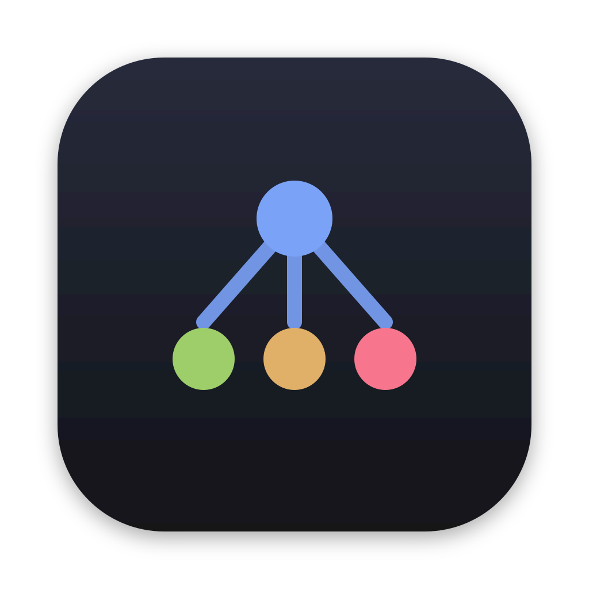
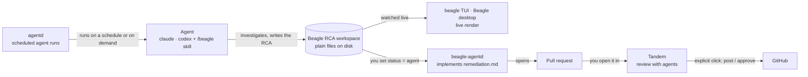

<div align="center">


# Beagle

Open-source developer tools for working alongside your AI agents — local-first, on your machine,
with you in control.

<a href="https://github.com/beagle-tools/beagle-tools/actions/workflows/ci.yml"></a>
<a href="LICENSE"></a>
<a href="https://github.com/beagle-tools/beagle-tools/releases?q=beagle-tandem-v"></a>
<a href="https://github.com/beagle-tools/beagle-tools/releases?q=beagle-rca-v"></a>
<a href="https://github.com/beagle-tools/beagle-tools/releases?q=beagle-workflows-v"></a>

</div>

## The tools

|                                                              | Product            | What it does                                                                                                               | Runs on                                              | Directory                           |
| ------------------------------------------------------------ | ------------------ | -------------------------------------------------------------------------------------------------------------------------- | ---------------------------------------------------- | ----------------------------------- |
|     | Tandem             | Review GitHub PRs with Claude/Codex riding along; agent comments stay local until you post                                 | macOS, Linux, Windows desktop                        | [`tandem/`](tandem/README.md)       |
|     | Beagle (RCA)       | An agent investigates an incident and writes the RCA; a TUI/desktop app renders it live; a daemon can ship the fix as a PR | CLI/TUI (macOS, Linux), desktop, daemon, static site | [`rca/`](rca/README.md)             |
|  | agentd + Agentdesk | Schedule coding agents from YAML manifests; each run in its own tmux session, recorded in SQLite                           | macOS                                                | [`workflows/`](workflows/README.md) |

Underneath them, [`utils/`](utils/README.md) (`beagle-utils`) holds the Rust helpers two or more
apps share.

> **Coming soon:** a unified `beagle` base CLI with extensions — see [#2](https://github.com/beagle-tools/beagle-tools/issues/2).

## Install

<details open>
<summary><b>Tandem</b> — desktop app</summary>

```sh
brew install --cask beagle-tools/tap/beagle-tandem
```

```sh
curl -fsSL https://raw.githubusercontent.com/beagle-tools/beagle-tools/main/tandem/scripts/install.sh | sh
```

```powershell
powershell -c "irm https://raw.githubusercontent.com/beagle-tools/beagle-tools/main/tandem/scripts/install.ps1 | iex"
```

Direct downloads for every platform: [`tandem/README.md`](tandem/README.md#install).

</details>

<details>
<summary><b>Beagle</b> — CLI/TUI, daemon and desktop app</summary>

```sh
brew install beagle-tools/tap/beagle-rca                  # CLI: beagle + beagle-agentd
brew install --cask beagle-tools/tap/beagle-rca-desktop   # the desktop app (macOS)
beagle skill install      # install the /beagle skill for Claude Code and Codex
```

Tarballs and `cargo install`: [`rca/README.md`](rca/README.md#install--run).

</details>

<details>
<summary><b>agentd + Agentdesk</b> — daemon, CLIs and desktop app (macOS)</summary>

```sh
brew install beagle-tools/tap/beagle-workflows          # agentd, agentctl, agenttop
brew install --cask beagle-tools/tap/beagle-agentdesk   # the Agentdesk app (optional)
agentctl daemon install
```

Direct downloads and the tmux/notifier setup: [`workflows/README.md`](workflows/README.md#install).

</details>

**How updates work:** the desktop apps update themselves in-app; the CLIs update with
`brew upgrade` (or `beagle update` for the Beagle CLI).

## Quick start

**Tandem:** open the app → sign in with `gh` → paste a PR URL.

**Beagle** — scaffold an RCA (`--title` is required), then watch it render live:

```sh
beagle new <slug> --title "..."
beagle                    # open the TUI against ./rcas
```

**agentd** — with the [demo manifests](workflows/manifests/) in `~/.config/agentd/manifests/`:

```sh
agentctl apply
agentctl get agents
agentctl -j hello -p name=you
agenttop
```

## How they fit together



Each tool stands on its own; together they cover an incident end to end. An agent — started by
you or by agentd — writes its investigation into a Beagle workspace that you watch live. When you
hand the RCA off, `beagle-agentd` implements the fix and opens a PR, which you review in Tandem
before anything reaches GitHub.

## Principles

- **Local-first:** SQLite and plain files on your disk; no hosted service in the loop.
- **You stay in control:** agents never post, approve or merge on their own — you click.
- **Bring any agent:** Claude, Codex, or a custom command.
- **One strict standard:** Rust with no `unsafe`, zero-warning builds, 400-line files, one CI
  `gate`.

## Repo layout

| Path                                | Purpose                                                                                     |
| ----------------------------------- | ------------------------------------------------------------------------------------------- |
| [`tandem/`](tandem/README.md)       | Tandem desktop app (Tauri 2 + Rust + React)                                                 |
| [`rca/`](rca/README.md)             | Beagle: `beagle` CLI/TUI, `beagle-agentd`, desktop app and postmortem site                  |
| [`workflows/`](workflows/README.md) | agentd, agentctl, agenttop and the Agentdesk desktop app                                    |
| [`utils/`](utils/README.md)         | `beagle-utils`, Rust helpers shared by two or more apps                                     |
| [`skills/`](skills/README.md)       | Agent skills: `/beagle`, `/beagle-review`, `/beagle-create-issue`, `/beagle-complete-issue` |
| [`standards/`](standards/)          | Shared lint and compiler config every app uses unchanged                                    |
| [`scripts/`](scripts/)              | CI gate, dev, release and GitHub scripts                                                    |
| [`packaging/`](packaging/)          | Homebrew formula templates and casks for `beagle-tools/tap`                                 |
| [`docs/`](docs/)                    | Monorepo docs: development, testing, standards, SDLC, releasing                             |

## Develop

```sh
make bootstrap            # install toolchains (Rust, Node via nvm, pnpm, gh, tmux)
make dev APP=tandem       # run any app — `scripts/dev/run.sh --list` for targets
make check                # exactly what CI runs (or make check-<app>)
```

| Doc                                                    | What's in it                                                   |
| ------------------------------------------------------ | -------------------------------------------------------------- |
| [`docs/DEVELOPMENT.md`](docs/DEVELOPMENT.md)           | Machine setup, starting each app, browser mode with mocked IPC |
| [`docs/TESTING.md`](docs/TESTING.md)                   | What tests a change needs, and how CI selects them             |
| [`docs/CODING_STANDARDS.md`](docs/CODING_STANDARDS.md) | The one set of rules every app follows                         |
| [`docs/SDLC.md`](docs/SDLC.md)                         | Issue → PR → `gate` → merge → release                          |
| [`docs/RELEASING.md`](docs/RELEASING.md)               | Per-app versions, tags, in-app updates and Homebrew            |
| [`CONTRIBUTING.md`](CONTRIBUTING.md)                   | How to send a change                                           |

## Working with agents

Coding agents start at [`AGENTS.md`](AGENTS.md). Work flows issue → PR → `gate` → squash-merge →
release ([`docs/SDLC.md`](docs/SDLC.md)), and two skills drive it: `/beagle-create-issue` specs the
work and `/beagle-complete-issue` takes an issue to a merged release ([`skills/README.md`](skills/README.md)).

## Support the project

If Beagle saves you time, help keep it going:

- **[Sponsor](https://github.com/sponsors/matthewmyrick)**
- **[Star the repo](https://github.com/beagle-tools/beagle-tools)**
- **[Report a bug](https://github.com/beagle-tools/beagle-tools/issues/new/choose)**
- **[Contribute](CONTRIBUTING.md)**

## License

Apache-2.0 — see [LICENSE](LICENSE).
