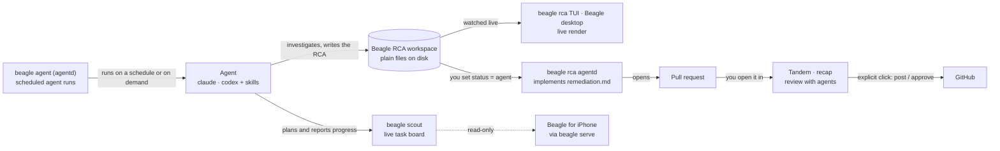

<div align="center">


# Beagle

**A pack of open-source dev tools for working alongside your AI agents.**<br>
Local-first, nose to the ground, and you always hold the leash.

<a href="https://github.com/beagle-tools/beagle-tools/actions/workflows/ci.yml"></a>
<a href="LICENSE"></a>
<a href="https://github.com/beagle-tools/beagle-tools/releases?q=beagle-cli-v"></a>
<a href="https://github.com/beagle-tools/beagle-tools/releases?q=beagle-tandem-v"></a>
<a href="https://github.com/beagle-tools/beagle-tools/releases?q=beagle-rca-v"></a>
<a href="https://github.com/beagle-tools/beagle-tools/releases?q=beagle-workflows-v"></a>

[Get started](docs/GETTING_STARTED.md) · [The tools](#meet-the-pack) · [Install](#install-in-one-minute) · [Contribute](CONTRIBUTING.md)

</div>

---

Coding agents are great at fetching. They are less great at telling you
what they found, why it matters and what they're about to chew on next.
Beagle is a set of small, sharp tools that keep you in the loop. You watch
the work live, read it in plain language and decide what reaches the
outside world. Your data stays on your machine.

```text
   __      _
o'')}____//     beagle setup     # skills, hooks and stores, all in one go
 `_/      )     beagle scout     # watch your agent work, task by task
 (_(_/-(_/      beagle doctor    # sniff out anything missing
```

## Meet the pack

| | Tool | What it does | Runs on |
|---|---|---|---|
|  | **[scout](scout/README.md)** | Your agent plans a goal as small, ordered tasks, and you watch it work through them live | CLI/TUI, iPhone |
|  | **[rca](rca/README.md)** | An agent investigates an incident and writes the root-cause analysis while you watch. Hand it off and a daemon opens the fix PR | CLI/TUI, desktop, daemon, static site |
|  | **[tandem](tandem/README.md)** | Review GitHub PRs with Claude or Codex riding along. Agent comments stay local until you post them | Desktop (macOS, Linux, Windows), TUI |
|  | **[agent](agent/README.md)** (agentd) | Schedule coding agents from YAML. Each run gets its own tmux session and is recorded in SQLite | CLI/TUI, daemon, macOS desktop |
|  | **[recap](recap/README.md)** | A PR's diff next to a plain-language write-up of what it fixes and why | CLI/TUI |
|  | **[standup](standup/README.md)** | Your standup, written for you: one overview, then a short write-up per ticket | CLI/TUI |
|  | **[Beagle for iPhone](ios/README.md)** | Every tool in your pocket, read-only, served from your Mac by `beagle serve` | iOS |

Every terminal tool and daemon lives in **one binary, `beagle`**
([`beagle/`](beagle/README.md)). Only the desktop apps and the iPhone app
install separately.

## Install in one minute

```sh
brew install beagle-tools/tap/beagle
beagle setup     # agent skills, scout hooks and store (asks before each step)
beagle doctor    # checks gh, tmux, agent services, skills and hooks
```

Then pick up whatever you need:

```sh
beagle agent daemon install                              # macOS: the agentd scheduler under launchd
beagle rca agent install                                 # the daemon that turns RCAs into fix PRs
brew install --cask beagle-tools/tap/beagle-tandem       # Tandem desktop
brew install --cask beagle-tools/tap/beagle-rca-desktop  # Beagle RCA desktop
brew install --cask beagle-tools/tap/beagle-agentdesk    # Agentdesk, agentd's desktop dashboard
```

**[docs/GETTING_STARTED.md](docs/GETTING_STARTED.md)** covers the full
setup: prerequisites, every tool's first run, the phone app, building from
source, and notes for coding agents setting up a machine. It also covers
tarballs, cargo, Linux and Windows.

<details>
<summary><b>Coming from the standalone tools?</b></summary>

`beagle` replaces them. Every old command now lives under its tool's name:

| Before | Now |
|---|---|
| `beagle list`, `beagle new …` (the old `beagle-rca` formula) | `beagle rca list`, `beagle rca new …` |
| `scout`, `recap`, `standup` | `beagle scout`, `beagle recap`, `beagle standup` |
| `tandem-cli …` | `beagle tandem …` |
| `agentctl …`, `agenttop`, `agentd` | `beagle agent …`, `beagle agent`, `beagle agent daemon run` |
| `beagle-agentd` | `beagle rca agentd run` |

```sh
brew uninstall beagle-rca beagle-workflows && brew install beagle-tools/tap/beagle
beagle setup && beagle agent daemon install && beagle rca agent install
beagle doctor    # lists old binaries still on your PATH
```

Full notes: [`beagle/README.md`](beagle/README.md#switching-from-the-standalone-tools).

</details>

## Thirty-second tour

```sh
# scout: in Claude Code, type `/scout make the login page remember the last email`,
# then watch it run from another terminal
beagle scout

# rca: scaffold an incident and watch the write-up appear
beagle rca new checkout-timeouts --title "Checkout times out under load"
beagle rca

# recap: pull a PR, ask your agent to "write the recap", then read it
beagle recap new https://github.com/acme/widgets/pull/42
beagle recap

# agent: run the free demo job from a checkout of this repo
mkdir -p ~/.config/agentd/manifests && cp -R agent/examples/demo ~/.config/agentd/manifests/
beagle agent apply && beagle agent -j writeup && beagle agent
```

## How they fit together



Each tool stands on its own. Together they cover the loop: agentd starts the
work, scout shows you what's happening, rca writes up what broke, a daemon
proposes the fix, and you review it in Tandem before anything reaches GitHub.

## House rules

- **Local-first.** SQLite and plain files on your disk. There is no hosted
  service in the loop.
- **You hold the leash.** Agents never post, approve or merge on their own.
  You click.
- **Bring any agent.** Claude, Codex or a custom command.
- **One strict standard.** Rust with no `unsafe`, zero-warning builds,
  400-line files and one CI `gate`.

## Repo map

Every tool is one top-level folder named like its `beagle` subcommand, with
one folder per part you can run ([`docs/LAYOUT.md`](docs/LAYOUT.md)).
`make standards` enforces it.

| Command | Folder | Parts |
| --- | --- | --- |
| `beagle` | [`beagle/`](beagle/README.md) | the command itself (help, update, doctor, setup) · [`serve/`](beagle/serve/) (`beagle serve`, the phone API) |
| `beagle agent` | [`agent/`](agent/README.md) | [`tui/`](agent/tui/) agentctl · [`daemon/`](agent/daemon/) agentd · [`desktop/`](agent/desktop/README.md) Agentdesk · [`lib/core`](agent/lib/core/) · [`lib/top`](agent/lib/top/) agenttop · [`examples/demo`](agent/examples/demo/) |
| `beagle rca` | [`rca/`](rca/README.md) | [`tui/`](rca/tui/) · [`daemon/`](rca/daemon/) `beagle rca agentd` · [`desktop/`](rca/desktop/README.md) Beagle app · [`web/`](rca/web/README.md) postmortem site · [`lib/agent`](rca/lib/agent/) · [`examples/rcas`](rca/examples/rcas/) |
| `beagle recap` | [`recap/`](recap/README.md) | [`tui/`](recap/tui/README.md) |
| `beagle scout` | [`scout/`](scout/README.md) | [`tui/`](scout/tui/README.md) |
| `beagle standup` | [`standup/`](standup/README.md) | [`tui/`](standup/tui/README.md) |
| `beagle tandem` | [`tandem/`](tandem/README.md) | [`tui/`](tandem/tui/) tandem-cli · [`desktop/`](tandem/desktop/) Tandem app · [`lib/`](tandem/lib/) core, github, cache, agents, queue |

Shared by every tool:

| Folder | What's in it |
| --- | --- |
| [`ios/`](ios/README.md) | The Beagle iPhone app: a home screen of every tool (Scout first), read-only through `beagle serve` |
| [`utils/`](utils/README.md) | `beagle-utils` and `beagle-tui`, the Rust helpers two or more tools share. Also `swift/` BeagleKit, the Swift package the iPhone app builds on |
| [`skills/`](skills/README.md) | Agent skills: `/beagle`, `/beagle-review`, `/beagle-create-issue`, `/beagle-complete-issue` |
| [`standards/`](standards/) | Shared lint and compiler config that every tool uses unchanged |
| [`scripts/`](scripts/) | CI gate, dev, release and GitHub scripts |
| [`packaging/`](packaging/) | Homebrew formula templates and casks for `beagle-tools/tap` |
| [`docs/`](docs/) | Monorepo docs: getting started, layout, development, testing, standards, SDLC, releasing, the serve API |

## Develop

```sh
git clone https://github.com/beagle-tools/beagle-tools.git && cd beagle-tools
make bootstrap            # Rust, Node via nvm, pnpm, gh, tmux (macOS; safe to re-run)
make dev APP=tandem       # run any app (scripts/dev/run.sh --list for targets)
make check                # exactly what CI runs (or make check-<app>)
```

| Doc | What's in it |
| --- | --- |
| [`docs/GETTING_STARTED.md`](docs/GETTING_STARTED.md) | Zero to running: install or build every tool, first runs, notes for agents |
| [`docs/DEVELOPMENT.md`](docs/DEVELOPMENT.md) | Machine setup, starting each app, browser mode with mocked IPC |
| [`docs/TESTING.md`](docs/TESTING.md) | What tests a change needs, and how CI selects them |
| [`docs/CODING_STANDARDS.md`](docs/CODING_STANDARDS.md) | The one set of rules every app follows |
| [`docs/SDLC.md`](docs/SDLC.md) | Issue → PR → `gate` → merge → release |
| [`docs/RELEASING.md`](docs/RELEASING.md) | Per-app versions, tags, in-app updates and Homebrew |
| [`docs/serve-api.md`](docs/serve-api.md), [`docs/serve-push.md`](docs/serve-push.md) | `beagle serve`: the read-only HTTPS API and push notifications for the phone app |
| [`CONTRIBUTING.md`](CONTRIBUTING.md) | How to send a change |

## Working with agents

Coding agents start at [`AGENTS.md`](AGENTS.md). Work flows issue → PR →
`gate` → squash-merge → release ([`docs/SDLC.md`](docs/SDLC.md)), and two
skills drive it. `/beagle-create-issue` specs the work, and
`/beagle-complete-issue` takes an issue all the way to a merged release
([`skills/README.md`](skills/README.md)).

## Support the project

If Beagle saves you time, throw it a treat:

- **[Sponsor](https://github.com/sponsors/matthewmyrick)**
- **[Star the repo](https://github.com/beagle-tools/beagle-tools)**
- **[Report a bug](https://github.com/beagle-tools/beagle-tools/issues/new/choose)**
- **[Contribute](CONTRIBUTING.md)**

## License

Apache-2.0. See [LICENSE](LICENSE).
