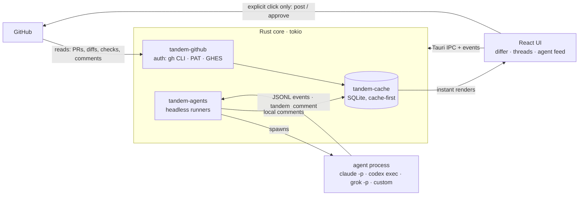
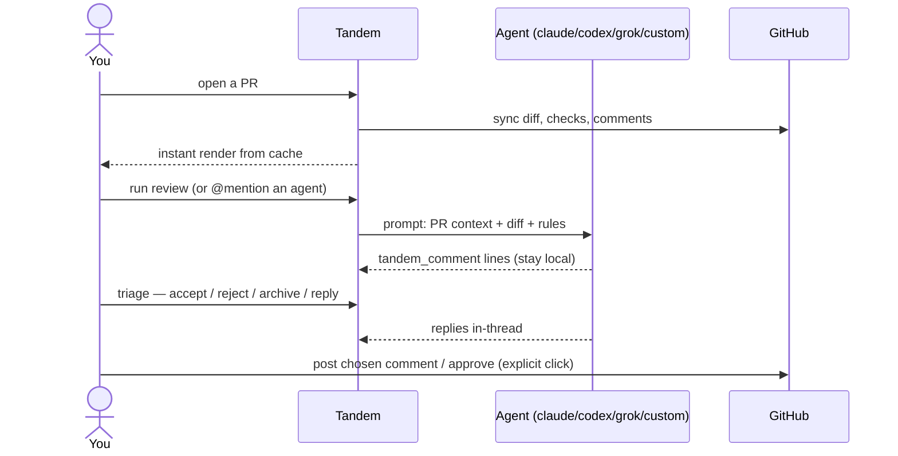

# Tandem

**Local-first code review that works with your agents.**

Tandem reviews GitHub pull requests with an AI agent riding along. It pulls
everything about a PR from GitHub (diff, checks, reviews, approvers,
comments), shows it in a fast differ, and lets an agent you already run
locally (Claude Code, Codex, Grok Build, or any command you like) review the
diff with you.

The twist: **agent comments never go to GitHub on their own.** They land as
local comments in Tandem, where you triage them (accept, reject, archive),
argue with them in threads (@mention any agent), and push a chosen comment
or an approval to GitHub only when you explicitly click post. Two riders,
one bike: the agents pedal, you steer. Think of it as a well-trained beagle:
it sniffs out every suspicious line, but it doesn't get to bark at your
teammates without permission.

Tandem comes in two shapes:

| You want…                                         | Use                                      | Install                                           |
| ------------------------------------------------- | ---------------------------------------- | ------------------------------------------------- |
| A desktop app: differ, threads, live agent feed   | **Tandem** (macOS, Windows, Linux)       | [Install the app](#install-the-desktop-app)       |
| A terminal queue: queue PRs, an agent reviews them, you triage in the terminal | **`beagle tandem`** (the review TUI) | [Install `beagle`](#install-the-terminal-tool-beagle-tandem) |
| JSON out of the app's store for scripts and agents | **`tandem-cli`** / `beagle tandem <command>` | ships with both of the above            |

Contents: [How it works](#how-it-works) ·
[Install](#install-the-desktop-app) · [Set up](#set-up-the-desktop-app) ·
[First review](#your-first-review-desktop) ·
[Terminal TUI](#the-review-tui-beagle-tandem) ·
[Safety](#what-agents-can-and-cant-do) · [Scripting](#scripting-tandem-cli) ·
[Troubleshooting](#troubleshooting) · [For agents](#for-coding-agents) ·
[Building](#building-from-source) · [Docs](#more-docs)

## How it works



And the review loop itself:



- **Cache-first.** The UI renders instantly from SQLite, background syncs
  refresh from GitHub, and sync state is always visible.
- **Bring your own AI.** Each agent runs a CLI you are already logged in to.
  Tandem never holds a model API key of its own; extra environment (a key, a
  custom endpoint variable) goes in the agent's `env`.
- **Agents know they're reviewing.** Each run gets a context block (the PR,
  the diff, your rules) and a simple contract: emit
  `{"type":"tandem_comment", ...}` lines. Inspired by
  [hunk](https://github.com/modem-dev/hunk).
- **Obvious logging.** Every run writes a JSONL event log you can tail in
  the UI or grep on disk.

## Install the desktop app

Install once; after that Tandem updates itself in-app.

**macOS (Homebrew).** Also puts `tandem-cli` on your PATH.

```sh
brew install --cask beagle-tools/tap/beagle-tandem
```

**macOS / Linux (install script).** Verifies the download's SHA-256 first.
On macOS it installs `/Applications/Tandem.app`; on Linux it installs the
`.deb` with apt/dpkg when `dpkg` exists (launch with `tandem`), otherwise the
AppImage as `~/.local/bin/tandem`.

```sh
curl -fsSL https://raw.githubusercontent.com/beagle-tools/beagle-tools/main/tandem/scripts/install.sh | sh
```

**Windows (install script).** Verifies the checksum, then runs the installer
silently.

```powershell
powershell -c "irm https://raw.githubusercontent.com/beagle-tools/beagle-tools/main/tandem/scripts/install.ps1 | iex"
```

**Direct downloads.** Stable links that always point at the newest release,
served from the rolling `beagle-tandem-latest` release (each has a `.sha256`
beside it):

| Platform            | Asset                                                                                                                                              |
| ------------------- | -------------------------------------------------------------------------------------------------------------------------------------------------- |
| macOS Apple silicon | [`Tandem-macos-arm64.dmg`](https://github.com/beagle-tools/beagle-tools/releases/download/beagle-tandem-latest/Tandem-macos-arm64.dmg)             |
| macOS Intel         | [`Tandem-macos-x64.dmg`](https://github.com/beagle-tools/beagle-tools/releases/download/beagle-tandem-latest/Tandem-macos-x64.dmg)                 |
| Windows x64         | [`Tandem-windows-x64-setup.exe`](https://github.com/beagle-tools/beagle-tools/releases/download/beagle-tandem-latest/Tandem-windows-x64-setup.exe) |
| Linux AppImage      | [`Tandem-linux-x86_64.AppImage`](https://github.com/beagle-tools/beagle-tools/releases/download/beagle-tandem-latest/Tandem-linux-x86_64.AppImage) |
| Linux deb           | [`Tandem-linux-amd64.deb`](https://github.com/beagle-tools/beagle-tools/releases/download/beagle-tandem-latest/Tandem-linux-amd64.deb)             |

Every version is also its own release, tagged `beagle-tandem-vX.Y.Z`:
[browse them](https://github.com/beagle-tools/beagle-tools/releases?q=beagle-tandem-v).

> **macOS:** builds aren't notarized yet. The install script and the
> Homebrew cask clear the quarantine flag for you. For a manual `.dmg`
> install, right-click → Open on first launch (or run
> `xattr -dr com.apple.quarantine /Applications/Tandem.app`).

**Updating.** Tandem checks for a new release on launch, every 30 minutes
and whenever the window regains focus. When one exists, an **update** button
appears in the header: one click downloads the signed bundle, installs it
and restarts. **Settings › Version** lists every published release and can
switch to any of them, including rolling back. Every bundle is
signature-checked either way.

## Install the terminal tool (`beagle tandem`)

The review TUI and the JSON CLI are part of the unified `beagle` command:

```sh
brew install beagle-tools/tap/beagle
beagle tandem --help
```

Other ways to get `beagle` (release tarballs, `cargo install`) are in
[`beagle/README.md`](../beagle/README.md). Update it with `beagle update`.

You don't need `beagle` for the desktop app, and you don't need the desktop
app for the review TUI: they keep separate stores. The same commands also
ship inside the app as `tandem-cli` (see [Scripting](#scripting-tandem-cli)).

## Set up the desktop app

### 1. Prerequisites

- **The `gh` CLI**, logged in: `gh auth login`. It is the easiest GitHub auth,
  and Tandem uses `gh repo clone` for the checkouts agents review in (without
  one, agents get the diff only).
  ([cli.github.com](https://cli.github.com))
- **At least one agent CLI**, installed and logged in on its own:
  [Claude Code](https://docs.anthropic.com/en/docs/claude-code) (`claude`),
  Codex (`codex`), Grok Build (`grok`), or any command of your own. Tandem
  adds the usual Homebrew/npm locations to `PATH`, so a Finder-launched app
  still finds them.

### 2. GitHub authentication

Open **Settings** (the gear in the header) › **GitHub authentication** and
pick one:

| Mode                       | What it does                                                                 |
| -------------------------- | ---------------------------------------------------------------------------- |
| gh CLI session (default)   | Runs `gh auth token`, so it is whoever `gh` is logged in as.                 |
| personal access token      | A PAT you paste in. Stored in the settings file (mode 0600), never the cache DB. |
| anonymous                  | Public repos only, heavily rate limited.                                     |

**API base** defaults to `https://api.github.com`; set it to your GitHub
Enterprise Server's `https://<host>/api/v3` to use GHES.

### 3. Track an org (or yourself)

**Settings › Organizations**: add an org or your own username. Every one of
its repos shows up in the picker on the home screen, where you can also
filter repos or paste a PR URL.

### 4. Add an agent

**Settings › Agents › new agent**. Each agent is one `AgentSpec`:

| Field                 | Meaning                                                                                                    |
| --------------------- | ---------------------------------------------------------------------------------------------------------- |
| name                  | Unique; it's how you @mention the agent in a thread.                                                       |
| runner                | `claude_headless`, `codex_headless`, `grok_headless`, or `custom` (a shell command; see below).            |
| model                 | Passed to the CLI (`--model` / `-m`); empty uses the CLI's default.                                        |
| prompt                | Your review instructions: what to look for, tone, severity bar.                                            |
| allowed tools         | Claude's `--allowedTools` (for example `Read,Grep,Glob`). The MCP checkboxes add `mcp__<server>` entries.  |
| append system prompt  | Extra text appended after Tandem's own review context.                                                     |
| env                   | Extra environment for the process (API keys, endpoint variables). Kept out of the DB, in `agent-env.json` (0600). |
| network allowlist     | Endpoints the agent may reach. **Informational until v2** ([SANDBOXING](docs/SANDBOXING.md)); pre-filled per runner. |
| timeout (minutes)     | Hard limit per run; default 15. The process is killed when it elapses.                                     |
| summary               | Also write the PR-level summary shown above the diff (on by default).                                      |

What each runner actually spawns (the prompt arrives on stdin unless noted):

| Runner           | Command                                                                                 |
| ---------------- | --------------------------------------------------------------------------------------- |
| `claude_headless` | `claude -p --output-format stream-json --verbose [--model …] [--allowedTools …]`       |
| `codex_headless`  | `codex exec --json --skip-git-repo-check --sandbox workspace-write [-m …] -`           |
| `grok_headless`   | `grok --output-format streaming-json --no-auto-update --always-approve [-m …] -p <prompt>` (prompt as an argument) |
| `custom`          | `/bin/sh -c '<your command>'`                                                          |

A custom agent's stdout is treated as the event stream: print
`{"type":"tandem_comment","path":…,"side":"new","line":…,"severity":…,"body":…}`
lines (or append them to `$TANDEM_COMMENTS_FILE`) and they become local
comments. `$TANDEM_RUN_ID` is set too. The full contract is in
[`AGENTS.md`](AGENTS.md#domain-rules).

### 5. Optional: config file (dotfiles-friendly)

Everything above is configurable in the GUI, but you can also declare
tracked orgs, a default repo, PR filters and sort, refresh interval and
agents in `~/.config/tandem/tandem.yaml` (or point `$TANDEM_CONFIG` at a
file). Present fields override GUI settings at startup, declared agents are
upserted by name, and unknown keys are an error. No file means no change.
See [`examples/tandem.yaml`](examples/tandem.yaml).

## Your first review (desktop)

1. Pick a repo on the home screen and open a PR (or paste its URL). The diff,
   checks and comments render from cache and refresh in the background.
2. Click **review** in the agent panel (or start one from a PR row) and pick
   an agent. Tandem checks the PR out into a managed clone when it can (it
   falls back to diff-only context otherwise), starts the agent there, and
   streams its events into the panel.
3. Comments appear inline in the diff. **Accept**, **reject**, **archive**
   or reply; @mention an agent in a thread to make it answer.
4. When a comment is worth sharing, **post** it to GitHub. **Approve** when
   you're happy. Nothing reaches GitHub until you click.

## The review TUI (`beagle tandem`)

`beagle tandem` with no arguments opens a terminal review queue. You queue
PRs; a reviewer claims each one and has an agent review it into **local**
comments, a summary and a verdict; you read the diff, summary and comments in
the terminal and post what you choose.

```text
add / `a` ──▶ queued ──claim──▶ reviewing ──ingest──▶ ready ──`m`──▶ done
                                    └──fail──▶ failed
```

Quick start:

```sh
gh auth login                                  # the TUI reads and writes through gh
beagle tandem add acme/widgets#123             # or a https://github.com/acme/widgets/pull/123 URL
beagle tandem                                  # open the queue; ? lists every key
```

Something has to do the reviewing. Anything that runs `claim`, then has an
agent write JSON lines and run `ingest`, will do. The ready-made reviewer is
the agentd job in
[`agent/examples/demo/review-queue.yaml`](../agent/examples/demo/review-queue.yaml);
tell the TUI to start it right after you queue a PR with `kick` in
`~/.config/beagle/tandem.toml`:

```toml
# All optional.
github_user = "octocat"   # the gh account posts and approvals use (`u` in the TUI sets it)
kick = ["beagle", "agent", "run", "demo/review-queue"]
```

In the TUI: `j`/`k` to move, `Enter` to open a PR, `1`/`2`/`3` for Summary,
Diff and Comments, `P` posts the selected comment, `A` approves (both ask
first and name the gh account), `x` dismisses, `m` marks it done, `a` queues
another, `q` quits. The diff uses `delta --side-by-side` when it is
installed. Full details, the reviewer's contract and every config key:
[`docs/CLI.md` › The review TUI](docs/CLI.md#the-review-tui).

## What agents can and can't do

v1 runs agents as local processes, with your user's permissions. Tandem
still takes GitHub write access away from them:

- **No GitHub writes from a run.** The agent gets a dummy `GH_TOKEN`, an
  empty `gh` config dir and no git credentials, so `gh` calls get 401. Claude
  runs also get `--disallowedTools` for `gh`, `git push` and `security`.
  Codex runs in its `workspace-write` sandbox.
- **Your writes are explicit.** Posting, approving and merging happen only
  on a click in the app or a confirmed keypress in the TUI.
- **Every run is bounded:** its own directory, a JSONL log, a timeout and a
  cancel button.

What v1 does **not** do is fence the network or the filesystem: the
`network_allowlist` is collected but not enforced, and a process running as
you could still read your keychain. **v2 moves agent runs into Docker behind
a squid egress proxy**, so each agent can reach only what you allowlist. See
[`docs/SANDBOXING.md`](docs/SANDBOXING.md).

## Scripting: `tandem-cli`

The app ships a JSON CLI over its local store (the cask puts it on PATH; on
macOS it lives at `Tandem.app/Contents/MacOS/tandem-cli`). `beagle tandem
<command>` is the same thing. It reads the store read-only, so it's safe while
the app is open: list cached PRs, comments (flat or threaded), summaries and
agent runs, see which requested reviews nothing has looked at yet, and queue a
review for the app to run with your agent config.

```sh
tandem-cli paths                                  # where everything lives
tandem-cli app-queue | jq -r '.[] | "\(.repo.owner)/\(.repo.name) \(.number)"'
tandem-cli app-review --repo acme/widgets --pr 123   # the app starts it within ~20 s, while it runs
tandem-cli comments --repo acme/widgets --pr 123 --threads --pretty
```

Full reference: [`docs/CLI.md`](docs/CLI.md).

## Where things live

`tandem-cli paths` prints the exact paths on your machine.

| What                     | Where                                                                    |
| ------------------------ | ------------------------------------------------------------------------ |
| App settings             | `<config dir>/tandem/settings.json`                                      |
| App cache + review data  | `<data dir>/tandem/cache.sqlite3` (agent env in `agent-env.json` beside it) |
| Agent run logs           | `<data dir>/tandem/runs/<run id>/events.jsonl`                           |
| Agent checkouts          | `<data dir>/tandem/worktrees/agent-runs/<owner>/<repo>/<n>`              |
| Optional app config file | `$TANDEM_CONFIG`, else `~/.config/tandem/tandem.yaml`                    |
| Review TUI store         | `<data dir>/tandem-tui/cache.sqlite3` (`$BEAGLE_TANDEM_ROOT` or config `root` moves it) |
| Review TUI config        | `~/.config/beagle/tandem.toml` (`$TANDEM_TUI_CONFIG` overrides)          |

`<data dir>` and `<config dir>` are the platform's own (on macOS both are
`~/Library/Application Support`). A `make dev` build uses `tandem-dev`
instead of `tandem`, so it never touches the installed app's data.

## Troubleshooting

| Symptom                                                         | Fix                                                                                                    |
| --------------------------------------------------------------- | ------------------------------------------------------------------------------------------------------ |
| "`gh auth token` failed — is the gh CLI logged in?"             | Run `gh auth login`, or switch **Settings › GitHub authentication** to a PAT. `beagle doctor` checks that `gh` is installed. |
| macOS says the app is damaged / can't be opened                 | It isn't notarized yet: `xattr -dr com.apple.quarantine /Applications/Tandem.app`, or right-click → Open. |
| An agent run fails right away                                   | Check that its CLI (`claude`, `codex`, `grok`) is installed and logged in; open the run's log in the agent panel, or read `runs/<run id>/events.jsonl`. |
| A run is killed partway                                         | It hit its timeout; raise the agent's **timeout** (default 15 minutes).                                |
| `tandem-cli`: "no database at … — open Tandem once, or pass --db" | Launch the app once so it creates its store, or point `--db` / `$TANDEM_DB` at one.                  |
| `app-review` never starts                                       | The desktop app works that queue only while it is running (every 20 s). `app-review` is not the TUI's queue; use `add` for that. |
| `beagle tandem add` warns nothing will review it                | No `kick` is configured and no reviewer has claimed a PR in 24 hours. Set `kick`, or schedule a reviewer. |
| TUI prints "warning: …tandem.toml: … (using defaults)"          | The config file has an unknown key or doesn't parse; fix it (`github_user`, `kick` and `root` are the only keys). |
| A TUI review shows failed after a long wait                     | A review still running after 45 minutes counts as failed. Press `e` to review it again.                |
| `beagle tandem update` is "unknown command"                     | By design: run `beagle update`. The app updates itself from its own update button.                    |

## For coding agents

- Read Tandem's data, don't write it: `tandem-cli` (or `beagle tandem`)
  prints JSON on stdout, errors on stderr with exit code 1. Start with
  `tandem-cli paths`, then `prs`, `comments --threads`, `summary`, `runs`.
- To get a PR reviewed by the user's configured agents, queue it:
  `tandem-cli app-review --repo acme/widgets --pr 123 --by my-agent` (desktop
  app) or `beagle tandem add acme/widgets#123` (review TUI).
- If you are the TUI's reviewer, follow `context.md` from `beagle tandem
  claim` exactly: one `tandem_verdict`, at most one `tandem_summary`, one
  `tandem_comment` per comment, then `ingest`. Never post to GitHub; the
  human does that.
- Working on Tandem's code? Start with [`AGENTS.md`](AGENTS.md) (architecture
  map, invariants, testing) and the repo-root [`AGENTS.md`](../AGENTS.md).

## Building from source

Prereqs: Rust (the toolchain pinned in the repo's `rust-toolchain.toml`
installs itself via rustup), Node (see the repo-root `.nvmrc`), pnpm via
`corepack enable`, and the `gh` CLI.

```sh
cd tandem
make install   # pnpm install
make dev       # Tandem Dev: a debug build with its own tandem-dev data
make check     # the CI gate (same as `make check-tandem` from the repo root)
```

Machine setup, browser-mode UI work and e2e:
[`docs/DEVELOPMENT.md`](../docs/DEVELOPMENT.md). How releases, tags and the
`beagle-tandem-latest` mirror work: [`docs/RELEASING.md`](../docs/RELEASING.md).
Standards: [`docs/CODING_STANDARDS.md`](../docs/CODING_STANDARDS.md);
contributor notes: [`CONTRIBUTING.md`](../CONTRIBUTING.md).

### Parts

| Part                         | What it is                                                                                           | Run it (from `tandem/`)                       |
| ---------------------------- | ---------------------------------------------------------------------------------------------------- | --------------------------------------------- |
| [`tui/`](tui/)               | `tandem-cli`: `beagle tandem` (the review TUI and JSON CLI), and the sidecar binary inside the app | `beagle tandem`, or `cargo run -p tandem-cli` |
| [`desktop/`](desktop/)       | The desktop app: Tauri shell (`desktop/src-tauri`) + React frontend (`desktop/src`)                  | `make dev`                                    |
| [`lib/core`](lib/core/)      | Domain types: PRs, diffs, local comments, agent specs                                                | —                                             |
| [`lib/github`](lib/github/)  | GitHub REST client: reads + explicit user-action writes                                              | —                                             |
| [`lib/cache`](lib/cache/)    | SQLite cache, local review store, 3-day merged-PR archive                                            | —                                             |
| [`lib/agents`](lib/agents/)  | Agent runners (headless claude/codex/grok/custom), JSONL logs                                        | —                                             |
| [`lib/queue`](lib/queue/)    | The terminal review queue (`tandem-tui`), linked by `tui/`                                           | —                                             |

Also here: `examples/` (a sample `tandem.yaml`), `assets/`, and `scripts/`
(the public `install.sh` / `install.ps1`, release version stamping).

## More docs

- [`docs/CLI.md`](docs/CLI.md): `tandem-cli` / `beagle tandem` reference, the
  two review queues, the review TUI and its reviewer contract.
- [`docs/ARCHITECTURE.md`](docs/ARCHITECTURE.md): crates, concurrency,
  cache-first data flow, the agent review flow.
- [`docs/SANDBOXING.md`](docs/SANDBOXING.md): what v1 enforces and the v2
  Docker + squid plan.
- [`docs/ROADMAP.md`](docs/ROADMAP.md): what's done and what's next.
- [`AGENTS.md`](AGENTS.md): the guide for agents changing Tandem's code.
